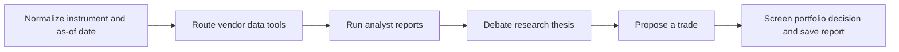
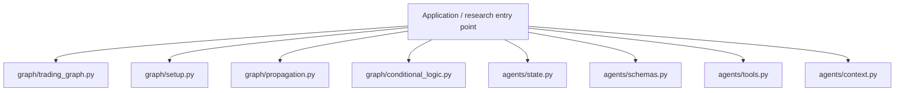
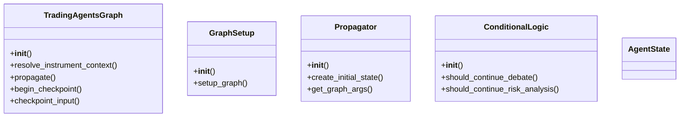
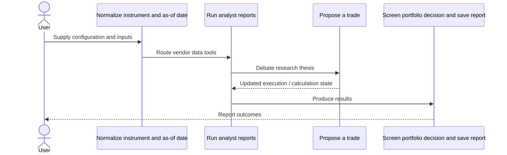
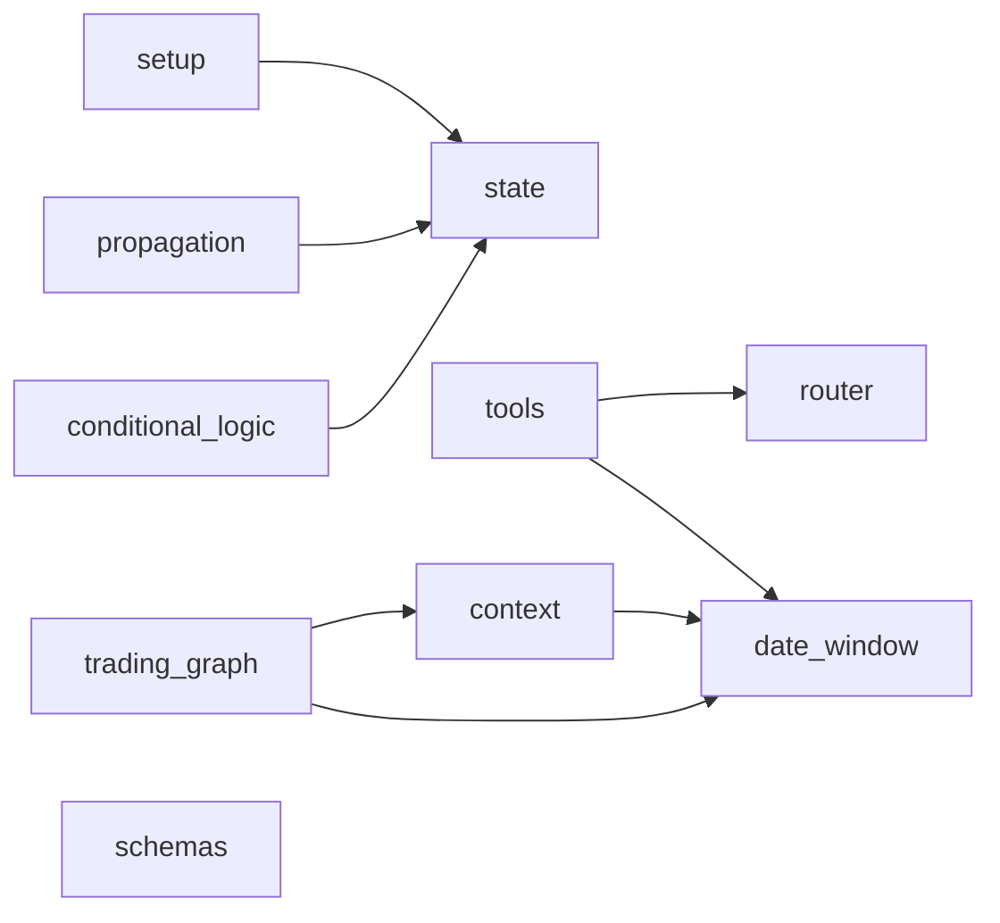
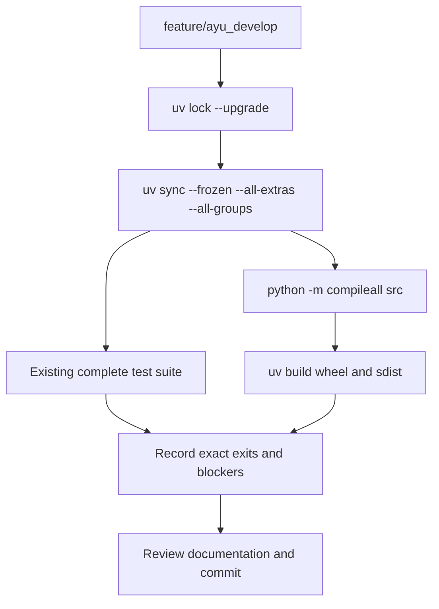

# TradingAgents: development, architecture and operations

Updated 2026-10-12 on `feature/ayu_develop`; source snapshot `96752b2a3f45`. This guide follows the source in this checkout and separates available interfaces from verification evidence.

## Purpose and feature boundaries

A LangGraph workflow that combines market, news, fundamentals and sentiment reports with researcher debates, trader proposals and portfolio risk decisions.

Provider-specific LLM clients normalize capabilities, reasoning configuration and authentication behind a factory. Vendor routing and date-window checks keep agent tools aligned with the requested evaluation time. The graph, structured schemas, portfolio context, checkpoints and memory log are separate concerns; live integration tests require real provider credentials.

## Main workflow

The following is the repository-specific logical workflow. Runtime execution details remain in the linked source and the validation record.

1. Normalize instrument and as-of date.
2. Route vendor data tools.
3. Run analyst reports.
4. Debate research thesis.
5. Propose a trade.
6. Screen portfolio decision and save report.

## Components and ownership

The entry point composes the source modules below; arrows indicate review/navigation boundaries rather than a claim that every module is called in every run.

| Source | Declared classes / functions | Implementation role |
|---|---|---|
| [src/tradingagents/graph/trading_graph.py](../src/tradingagents/graph/trading_graph.py) | TradingAgentsGraph; _validate_trade_date | See the public declarations and implementation linked here. |
| [src/tradingagents/graph/setup.py](../src/tradingagents/graph/setup.py) | GraphSetup; _tools_or_done, _analyst_graph | See the public declarations and implementation linked here. |
| [src/tradingagents/graph/propagation.py](../src/tradingagents/graph/propagation.py) | Propagator | See the public declarations and implementation linked here. |
| [src/tradingagents/graph/conditional_logic.py](../src/tradingagents/graph/conditional_logic.py) | ConditionalLogic | See the public declarations and implementation linked here. |
| [src/tradingagents/agents/state.py](../src/tradingagents/agents/state.py) | InvestDebateState, RiskDebateState, AgentState | See the public declarations and implementation linked here. |
| [src/tradingagents/agents/schemas.py](../src/tradingagents/agents/schemas.py) | PortfolioRating, TraderAction, ResearchPlan, TraderProposal, PortfolioDecision, SentimentBand; _coerce_optional_float, render_research_plan, render_trader_proposal, render_pm_decision | Pydantic schemas used by agents that produce structured output. |
| [src/tradingagents/agents/tools.py](../src/tradingagents/agents/tools.py) | get_stock_data, get_indicators, get_verified_market_snapshot, get_fundamentals | The data tools the analysts call. |
| [src/tradingagents/agents/context.py](../src/tradingagents/agents/context.py) | get_language_instruction, opponent_argument_or_opening, _clean_identity_value, resolve_instrument_identity | Prompt context shared by the agents: instrument identity, output language and portfolio. |
| [src/tradingagents/dataflows/router.py](../src/tradingagents/dataflows/router.py) | get_category_for_method, get_vendor, vendor_unavailable, no_data_available | See the public declarations and implementation linked here. |
| [src/tradingagents/dataflows/date_window.py](../src/tradingagents/dataflows/date_window.py) | to_utc, in_window, get_current_date, is_historical | Point-in-time rules shared by every dated path: data is served as of the run's date. |
| [src/tradingagents/dataflows/files.py](../src/tradingagents/dataflows/files.py) | replace_file, locked, _hold_posix, _hold_windows | Files written whole, and held by one writer at a time, under concurrent writers. |
| [src/tradingagents/llm_clients/factory.py](../src/tradingagents/llm_clients/factory.py) | create_llm_client, _coerce_max_retries, _coerce_max_tokens, build_llm_kwargs | See the public declarations and implementation linked here. |
| [src/tradingagents/memory/log.py](../src/tradingagents/memory/log.py) | TradingMemoryLog | The memory log: an append-only markdown record of each decision and, once settled, its outcome. |
| [src/tradingagents/portfolio.py](../src/tradingagents/portfolio.py) | Position, PortfolioContext; load_portfolio | The caller's book, as the decision agents see it. |
| [src/tradingagents/reporting.py](../src/tradingagents/reporting.py) | analyst_names, _header, _report_parts, write_report_tree | Reusable report-tree writer shared by the CLI and the programmatic API. |

## Class design

Methods and inheritance edges are taken from the selected declarations in the actual source. A missing edge means composition or an external base is not asserted here.

## End-to-end interaction

This sequence presents the responsibilities of the main workflow, including the state/result boundary. The linked classes and functions provide the exact method-level contract.

## Source dependency direction

These edges are actual explicit imports between the selected source modules. Dynamic imports, re-exports and third-party internals are omitted.

## Design details and extension points

### `TradingAgentsGraph`

Source: [src/tradingagents/graph/trading_graph.py](../src/tradingagents/graph/trading_graph.py).

Main class that orchestrates the trading agents framework.

- `resolve_instrument_context`: Resolve ticker identity once and return the full instrument context.
- `propagate`: Run the trading agents graph for a company on a specific date.
- `begin_checkpoint`: Recompile the graph with a per-ticker checkpointer and return the ``thread_id`` to inject into the stream/invoke ``config`` (or ``None`` when checkpointing is disabled).
- `checkpoint_input`: The value to stream/invoke: ``None`` to resume an existing checkpoint, else the initial state for a fresh run.
- `end_checkpoint`: Restore the plain uncheckpointed graph after a checkpointed run.

### `GraphSetup`

Source: [src/tradingagents/graph/setup.py](../src/tradingagents/graph/setup.py).

Handles the setup and configuration of the agent graph.

- `setup_graph`: Set up and compile the agent workflow graph.

### `Propagator`

Source: [src/tradingagents/graph/propagation.py](../src/tradingagents/graph/propagation.py).

Handles state initialization and propagation through the graph.

- `create_initial_state`: Create the initial state for the agent graph.
- `get_graph_args`: Get arguments for the graph invocation.

### `ConditionalLogic`

Source: [src/tradingagents/graph/conditional_logic.py](../src/tradingagents/graph/conditional_logic.py).

Handles conditional logic for determining graph flow.

- `should_continue_debate`: Determine if debate should continue.
- `should_continue_risk_analysis`: Determine if risk analysis should continue.

### `AgentState`

Source: [src/tradingagents/agents/state.py](../src/tradingagents/agents/state.py).

The class contract is defined by its linked implementation.

## Repository layout and resources

Installable packages live under `src/`. `pyproject.toml` defines package metadata, build requirements, optional integrations and development dependencies; `uv.lock` records resolved versions, and `.python-version` selects the local interpreter. This layout keeps an accidental checkout import from substituting for the installed wheel. Package resources remain beside their owning modules and are included by the build backend. Existing upstream examples, fixtures, scripts and documentation retain their separate roles.

## Maintenance compatibility and evidence

- The upstream graph/vendor/CLI refactor is retained under src. Setuptools dynamic version metadata matches the existing version test and ships CLI assets.
- Cache retry uses the portable EDEADLK errno alias; existing errno and i18n path cases were updated without adding cases.
- Python 3.15 actual source build rejects ormsgpack 1.12.2: its PyO3 0.27.2 declares maximum Python 3.14.

## Development and verification workflow

See [development commands](development.md) and [validation evidence](validation.md) for interpreter selection, dependency exceptions, full-suite results and remaining blockers. No additional test cases were introduced by this maintenance.
