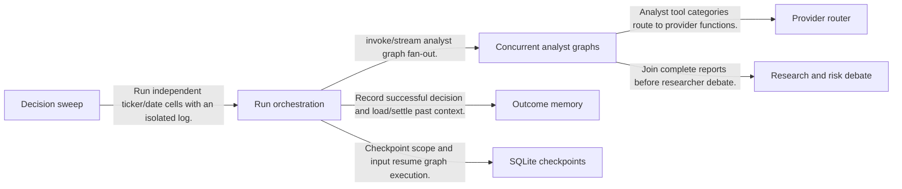
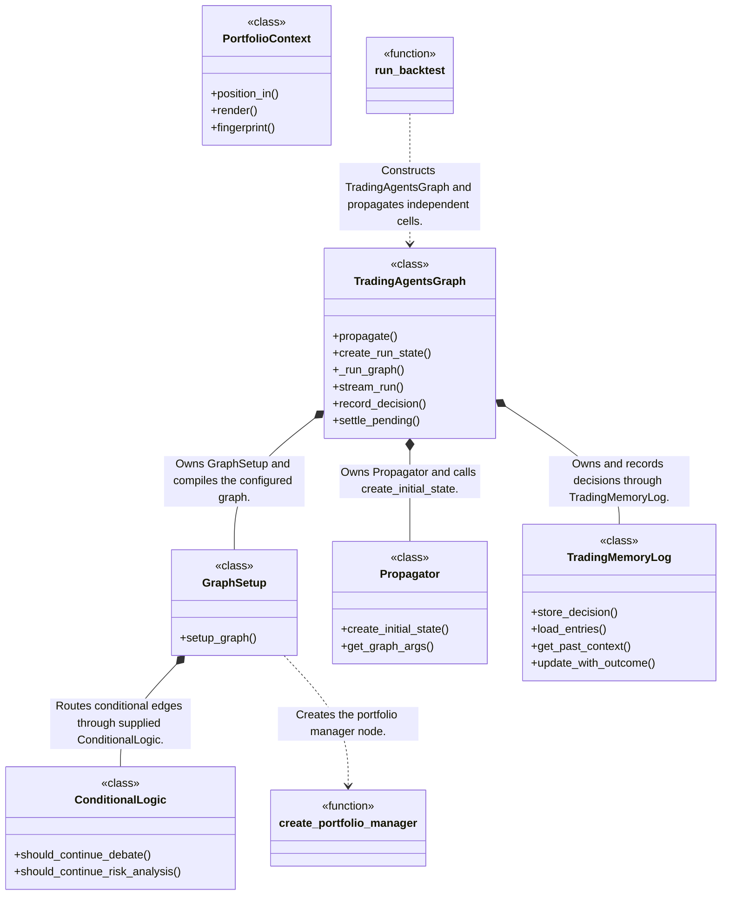
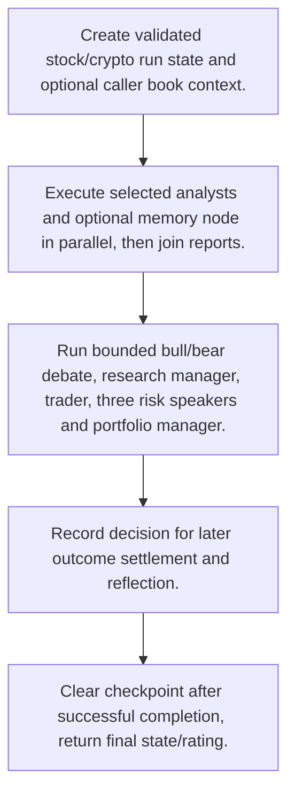
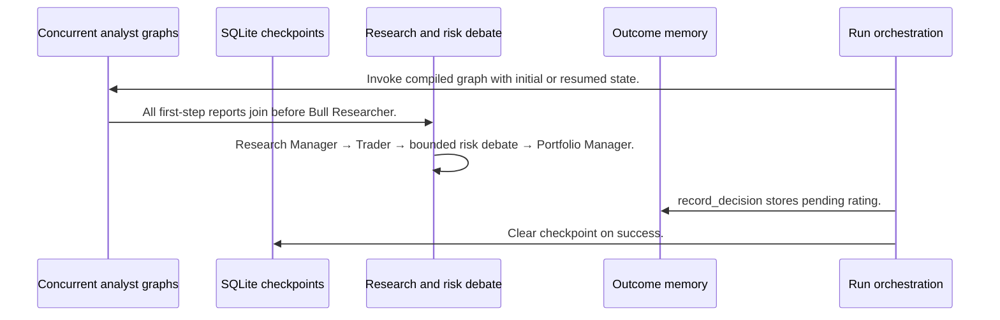

# TradingAgents: workflow, design and architecture

Updated: **2026-10-13**
Reviewed Git hash: `be027e55e7b59c0a48804f2d42c6404d36e5c15b`
Branch: `feature/ayu_develop`
Source diff SHA256: `e3b0c44298fc1c149afbf4c8996fb92427ae41e4649b934ca495991b7852b855`
Scope: **Agent decision research** / Maintenance: **active**
Languages: Python

[HTML edition](ayu-develop.html) / [Development](development.md) / [Historical validation](validation.md) / [Full system comparison](../../docs/index.html)

## Purpose and scope

LangGraph stock/crypto research and debate system producing typed ratings, resumable reports and outcome-based memory; decision-quality sweeps rather than portfolio fill simulation.

## Features and support boundaries

Native = implemented here. Integration = supplied through a named host/API. Limited = material restriction. Not provided = evidenced scope exclusion. Unverified = support/absence not established. Not applicable = outside this artifact type.

| Capability | Status | Implementation and limits | Source |
|---|---|---|---|
| Backtesting | Limited | Decision-quality grid evaluates independent ratings/outcomes. Source explicitly excludes carried-forward positions, fills and cash ledger. | [run_backtest](../src/tradingagents/backtest.py) ([L129](https://github.com/alexcwyu/TradingAgents/blob/be027e55e7b59c0a48804f2d42c6404d36e5c15b/src/tradingagents/backtest.py#L129)) |
| Live execution | Not provided | Produces a structured research rating/thesis; no quantity/fill/cash ledger or broker execution path is provided by this decision runtime. | [run_backtest](../src/tradingagents/backtest.py) ([L129](https://github.com/alexcwyu/TradingAgents/blob/be027e55e7b59c0a48804f2d42c6404d36e5c15b/src/tradingagents/backtest.py#L129)) / [PortfolioContext](../src/tradingagents/portfolio.py) ([L29](https://github.com/alexcwyu/TradingAgents/blob/be027e55e7b59c0a48804f2d42c6404d36e5c15b/src/tradingagents/portfolio.py#L29)) / [create_portfolio_manager](../src/tradingagents/agents/managers/portfolio_manager.py) ([L23](https://github.com/alexcwyu/TradingAgents/blob/be027e55e7b59c0a48804f2d42c6404d36e5c15b/src/tradingagents/agents/managers/portfolio_manager.py#L23)) |
| Paper trading | Not provided | Produces a structured research rating/thesis; no quantity/fill/cash ledger or broker execution path is provided by this decision runtime. | [run_backtest](../src/tradingagents/backtest.py) ([L129](https://github.com/alexcwyu/TradingAgents/blob/be027e55e7b59c0a48804f2d42c6404d36e5c15b/src/tradingagents/backtest.py#L129)) / [PortfolioContext](../src/tradingagents/portfolio.py) ([L29](https://github.com/alexcwyu/TradingAgents/blob/be027e55e7b59c0a48804f2d42c6404d36e5c15b/src/tradingagents/portfolio.py#L29)) / [create_portfolio_manager](../src/tradingagents/agents/managers/portfolio_manager.py) ([L23](https://github.com/alexcwyu/TradingAgents/blob/be027e55e7b59c0a48804f2d42c6404d36e5c15b/src/tradingagents/agents/managers/portfolio_manager.py#L23)) |
| Event driven | Limited | LangGraph node state transitions and run stream events exist; not a market-event trading engine. | [GraphSetup](../src/tradingagents/graph/setup.py) ([L93](https://github.com/alexcwyu/TradingAgents/blob/be027e55e7b59c0a48804f2d42c6404d36e5c15b/src/tradingagents/graph/setup.py#L93)) / [_run_graph](../src/tradingagents/graph/trading_graph.py) ([L372](https://github.com/alexcwyu/TradingAgents/blob/be027e55e7b59c0a48804f2d42c6404d36e5c15b/src/tradingagents/graph/trading_graph.py#L372)) |
| Vectorized | Unverified | Not established by the inspected implementation boundaries; no absence or production claim is made. | Not applicable to this repository scope. |
| Order management | Not provided | Produces a structured research rating/thesis; no quantity/fill/cash ledger or broker execution path is provided by this decision runtime. | [run_backtest](../src/tradingagents/backtest.py) ([L129](https://github.com/alexcwyu/TradingAgents/blob/be027e55e7b59c0a48804f2d42c6404d36e5c15b/src/tradingagents/backtest.py#L129)) / [PortfolioContext](../src/tradingagents/portfolio.py) ([L29](https://github.com/alexcwyu/TradingAgents/blob/be027e55e7b59c0a48804f2d42c6404d36e5c15b/src/tradingagents/portfolio.py#L29)) / [create_portfolio_manager](../src/tradingagents/agents/managers/portfolio_manager.py) ([L23](https://github.com/alexcwyu/TradingAgents/blob/be027e55e7b59c0a48804f2d42c6404d36e5c15b/src/tradingagents/agents/managers/portfolio_manager.py#L23)) |
| Order types | Not provided | Produces a structured research rating/thesis; no quantity/fill/cash ledger or broker execution path is provided by this decision runtime. | [run_backtest](../src/tradingagents/backtest.py) ([L129](https://github.com/alexcwyu/TradingAgents/blob/be027e55e7b59c0a48804f2d42c6404d36e5c15b/src/tradingagents/backtest.py#L129)) / [PortfolioContext](../src/tradingagents/portfolio.py) ([L29](https://github.com/alexcwyu/TradingAgents/blob/be027e55e7b59c0a48804f2d42c6404d36e5c15b/src/tradingagents/portfolio.py#L29)) / [create_portfolio_manager](../src/tradingagents/agents/managers/portfolio_manager.py) ([L23](https://github.com/alexcwyu/TradingAgents/blob/be027e55e7b59c0a48804f2d42c6404d36e5c15b/src/tradingagents/agents/managers/portfolio_manager.py#L23)) |
| Multi venue | Unverified | Not established by the inspected implementation boundaries; no absence or production claim is made. | Not applicable to this repository scope. |
| Crypto | Integration | Graph resolves stock/crypto instrument context; provider APIs supply market research data. Market support is analysis, not venue execution. | [TradingAgentsGraph](../src/tradingagents/graph/trading_graph.py) ([L51](https://github.com/alexcwyu/TradingAgents/blob/be027e55e7b59c0a48804f2d42c6404d36e5c15b/src/tradingagents/graph/trading_graph.py#L51)) / [src/tradingagents/dataflows/router.py](../src/tradingagents/dataflows/router.py) ([L97](https://github.com/alexcwyu/TradingAgents/blob/be027e55e7b59c0a48804f2d42c6404d36e5c15b/src/tradingagents/dataflows/router.py#L97)) |
| Equities | Integration | Graph resolves stock/crypto instrument context; provider APIs supply market research data. Market support is analysis, not venue execution. | [TradingAgentsGraph](../src/tradingagents/graph/trading_graph.py) ([L51](https://github.com/alexcwyu/TradingAgents/blob/be027e55e7b59c0a48804f2d42c6404d36e5c15b/src/tradingagents/graph/trading_graph.py#L51)) / [src/tradingagents/dataflows/router.py](../src/tradingagents/dataflows/router.py) ([L97](https://github.com/alexcwyu/TradingAgents/blob/be027e55e7b59c0a48804f2d42c6404d36e5c15b/src/tradingagents/dataflows/router.py#L97)) |
| Futures | Unverified | Not established by the inspected implementation boundaries; no absence or production claim is made. | Not applicable to this repository scope. |
| Options | Unverified | Not established by the inspected implementation boundaries; no absence or production claim is made. | Not applicable to this repository scope. |
| Forex | Unverified | Not established by the inspected implementation boundaries; no absence or production claim is made. | Not applicable to this repository scope. |
| Strategy api | Limited | Selectable analysts and configurable graph roles extend decision research; broker-neutral strategy execution is not provided. | [TradingAgentsGraph](../src/tradingagents/graph/trading_graph.py) ([L51](https://github.com/alexcwyu/TradingAgents/blob/be027e55e7b59c0a48804f2d42c6404d36e5c15b/src/tradingagents/graph/trading_graph.py#L51)) / [GraphSetup](../src/tradingagents/graph/setup.py) ([L93](https://github.com/alexcwyu/TradingAgents/blob/be027e55e7b59c0a48804f2d42c6404d36e5c15b/src/tradingagents/graph/setup.py#L93)) |
| Optimization | Unverified | Not established by the inspected implementation boundaries; no absence or production claim is made. | Not applicable to this repository scope. |
| Machine learning | Integration | Configured external LLMs generate analyst reports/debate decisions; this is inference orchestration, not native supervised model training. | [TradingAgentsGraph](../src/tradingagents/graph/trading_graph.py) ([L51](https://github.com/alexcwyu/TradingAgents/blob/be027e55e7b59c0a48804f2d42c6404d36e5c15b/src/tradingagents/graph/trading_graph.py#L51)) / [create_portfolio_manager](../src/tradingagents/agents/managers/portfolio_manager.py) ([L23](https://github.com/alexcwyu/TradingAgents/blob/be027e55e7b59c0a48804f2d42c6404d36e5c15b/src/tradingagents/agents/managers/portfolio_manager.py#L23)) |
| Reinforcement learning | Unverified | Not established by the inspected implementation boundaries; no absence or production claim is made. | Not applicable to this repository scope. |
| Portfolio | Limited | Caller-supplied positions/cash inform a decision and fingerprint resume state; cells do not carry a simulated portfolio forward. | [PortfolioContext](../src/tradingagents/portfolio.py) ([L29](https://github.com/alexcwyu/TradingAgents/blob/be027e55e7b59c0a48804f2d42c6404d36e5c15b/src/tradingagents/portfolio.py#L29)) / [run_backtest](../src/tradingagents/backtest.py) ([L129](https://github.com/alexcwyu/TradingAgents/blob/be027e55e7b59c0a48804f2d42c6404d36e5c15b/src/tradingagents/backtest.py#L129)) |
| Risk management | Limited | Risk analyst debate and manager reasoning are advisory; no executable pre-trade account limits are established. | [GraphSetup](../src/tradingagents/graph/setup.py) ([L93](https://github.com/alexcwyu/TradingAgents/blob/be027e55e7b59c0a48804f2d42c6404d36e5c15b/src/tradingagents/graph/setup.py#L93)) / [create_portfolio_manager](../src/tradingagents/agents/managers/portfolio_manager.py) ([L23](https://github.com/alexcwyu/TradingAgents/blob/be027e55e7b59c0a48804f2d42c6404d36e5c15b/src/tradingagents/agents/managers/portfolio_manager.py#L23)) |
| Performance analytics | Limited | Settles decisions against realized and benchmark returns; independent rating scoring is not execution P&L. | [run_backtest](../src/tradingagents/backtest.py) ([L129](https://github.com/alexcwyu/TradingAgents/blob/be027e55e7b59c0a48804f2d42c6404d36e5c15b/src/tradingagents/backtest.py#L129)) / [settle_pending](../src/tradingagents/memory/settlement.py) ([L109](https://github.com/alexcwyu/TradingAgents/blob/be027e55e7b59c0a48804f2d42c6404d36e5c15b/src/tradingagents/memory/settlement.py#L109)) |
| Historical data | Integration | Vendor router supplies historical OHLCV/fundamental/news inputs; date-filtered analysis depends on provider availability. | [src/tradingagents/dataflows/router.py](../src/tradingagents/dataflows/router.py) ([L97](https://github.com/alexcwyu/TradingAgents/blob/be027e55e7b59c0a48804f2d42c6404d36e5c15b/src/tradingagents/dataflows/router.py#L97)) / [TradingAgentsGraph](../src/tradingagents/graph/trading_graph.py) ([L51](https://github.com/alexcwyu/TradingAgents/blob/be027e55e7b59c0a48804f2d42c6404d36e5c15b/src/tradingagents/graph/trading_graph.py#L51)) |
| Streaming data | Limited | stream_run streams agent messages/state; this is not a verified real-time exchange feed. | [_run_graph](../src/tradingagents/graph/trading_graph.py) ([L372](https://github.com/alexcwyu/TradingAgents/blob/be027e55e7b59c0a48804f2d42c6404d36e5c15b/src/tradingagents/graph/trading_graph.py#L372)) |
| Persistence | Native | Per-ticker SQLite graph checkpoints and locked markdown decision memory are implemented. | [get_checkpointer](../src/tradingagents/graph/checkpointer.py) ([L42](https://github.com/alexcwyu/TradingAgents/blob/be027e55e7b59c0a48804f2d42c6404d36e5c15b/src/tradingagents/graph/checkpointer.py#L42)) / [TradingMemoryLog](../src/tradingagents/memory/log.py) ([L11](https://github.com/alexcwyu/TradingAgents/blob/be027e55e7b59c0a48804f2d42c6404d36e5c15b/src/tradingagents/memory/log.py#L11)) |
| Data pipeline | Integration | Vendor router supplies historical OHLCV/fundamental/news inputs; date-filtered analysis depends on provider availability. | [src/tradingagents/dataflows/router.py](../src/tradingagents/dataflows/router.py) ([L97](https://github.com/alexcwyu/TradingAgents/blob/be027e55e7b59c0a48804f2d42c6404d36e5c15b/src/tradingagents/dataflows/router.py#L97)) / [TradingAgentsGraph](../src/tradingagents/graph/trading_graph.py) ([L51](https://github.com/alexcwyu/TradingAgents/blob/be027e55e7b59c0a48804f2d42c6404d36e5c15b/src/tradingagents/graph/trading_graph.py#L51)) |
| Web ui | Unverified | Not established by the inspected implementation boundaries; no absence or production claim is made. | Not applicable to this repository scope. |
| Cli | Unverified | Not established by the inspected implementation boundaries; no absence or production claim is made. | Not applicable to this repository scope. |
| Monitoring | Native | Run streaming and logged decisions expose research progress and outcomes. | [_run_graph](../src/tradingagents/graph/trading_graph.py) ([L372](https://github.com/alexcwyu/TradingAgents/blob/be027e55e7b59c0a48804f2d42c6404d36e5c15b/src/tradingagents/graph/trading_graph.py#L372)) / [TradingMemoryLog](../src/tradingagents/memory/log.py) ([L11](https://github.com/alexcwyu/TradingAgents/blob/be027e55e7b59c0a48804f2d42c6404d36e5c15b/src/tradingagents/memory/log.py#L11)) |
| Extension api | Limited | Selectable analysts and configurable graph roles extend decision research; broker-neutral strategy execution is not provided. | [TradingAgentsGraph](../src/tradingagents/graph/trading_graph.py) ([L51](https://github.com/alexcwyu/TradingAgents/blob/be027e55e7b59c0a48804f2d42c6404d36e5c15b/src/tradingagents/graph/trading_graph.py#L51)) / [GraphSetup](../src/tradingagents/graph/setup.py) ([L93](https://github.com/alexcwyu/TradingAgents/blob/be027e55e7b59c0a48804f2d42c6404d36e5c15b/src/tradingagents/graph/setup.py#L93)) |
| Native acceleration | Unverified | Not established by the inspected implementation boundaries; no absence or production claim is made. | Not applicable to this repository scope. |
| Distributed execution | Unverified | Not established by the inspected implementation boundaries; no absence or production claim is made. | Not applicable to this repository scope. |

## System components

| Component | Responsibility | Source |
|---|---|---|
| Run orchestration | Creates state, executes graph and writes successful decisions. | [TradingAgentsGraph](../src/tradingagents/graph/trading_graph.py) ([L51](https://github.com/alexcwyu/TradingAgents/blob/be027e55e7b59c0a48804f2d42c6404d36e5c15b/src/tradingagents/graph/trading_graph.py#L51)) / [_run_graph](../src/tradingagents/graph/trading_graph.py) ([L372](https://github.com/alexcwyu/TradingAgents/blob/be027e55e7b59c0a48804f2d42c6404d36e5c15b/src/tradingagents/graph/trading_graph.py#L372)) / [Propagator](../src/tradingagents/graph/propagation.py) ([L6](https://github.com/alexcwyu/TradingAgents/blob/be027e55e7b59c0a48804f2d42c6404d36e5c15b/src/tradingagents/graph/propagation.py#L6)) |
| Concurrent analyst graphs | Tools and analysts produce reports in parallel before a join. | [GraphSetup](../src/tradingagents/graph/setup.py) ([L93](https://github.com/alexcwyu/TradingAgents/blob/be027e55e7b59c0a48804f2d42c6404d36e5c15b/src/tradingagents/graph/setup.py#L93)) / [src/tradingagents/dataflows/router.py](../src/tradingagents/dataflows/router.py) ([L97](https://github.com/alexcwyu/TradingAgents/blob/be027e55e7b59c0a48804f2d42c6404d36e5c15b/src/tradingagents/dataflows/router.py#L97)) |
| Research and risk debate | Bounded alternating researchers and risk speakers route to manager decisions. | [GraphSetup](../src/tradingagents/graph/setup.py) ([L93](https://github.com/alexcwyu/TradingAgents/blob/be027e55e7b59c0a48804f2d42c6404d36e5c15b/src/tradingagents/graph/setup.py#L93)) / [ConditionalLogic](../src/tradingagents/graph/conditional_logic.py) ([L4](https://github.com/alexcwyu/TradingAgents/blob/be027e55e7b59c0a48804f2d42c6404d36e5c15b/src/tradingagents/graph/conditional_logic.py#L4)) / [create_portfolio_manager](../src/tradingagents/agents/managers/portfolio_manager.py) ([L23](https://github.com/alexcwyu/TradingAgents/blob/be027e55e7b59c0a48804f2d42c6404d36e5c15b/src/tradingagents/agents/managers/portfolio_manager.py#L23)) |
| Provider router | Retrieves prices, indicators, filings/news and optional enrichments. | [src/tradingagents/dataflows/router.py](../src/tradingagents/dataflows/router.py) ([L97](https://github.com/alexcwyu/TradingAgents/blob/be027e55e7b59c0a48804f2d42c6404d36e5c15b/src/tradingagents/dataflows/router.py#L97)) |
| Outcome memory | Appends decisions and later settles realized/benchmark returns with reflections. | [TradingMemoryLog](../src/tradingagents/memory/log.py) ([L11](https://github.com/alexcwyu/TradingAgents/blob/be027e55e7b59c0a48804f2d42c6404d36e5c15b/src/tradingagents/memory/log.py#L11)) / [settle_pending](../src/tradingagents/memory/settlement.py) ([L109](https://github.com/alexcwyu/TradingAgents/blob/be027e55e7b59c0a48804f2d42c6404d36e5c15b/src/tradingagents/memory/settlement.py#L109)) |
| SQLite checkpoints | Saves per-ticker graph progress and supports shape-specific resume. | [get_checkpointer](../src/tradingagents/graph/checkpointer.py) ([L42](https://github.com/alexcwyu/TradingAgents/blob/be027e55e7b59c0a48804f2d42c6404d36e5c15b/src/tradingagents/graph/checkpointer.py#L42)) / [_run_graph](../src/tradingagents/graph/trading_graph.py) ([L372](https://github.com/alexcwyu/TradingAgents/blob/be027e55e7b59c0a48804f2d42c6404d36e5c15b/src/tradingagents/graph/trading_graph.py#L372)) |
| Decision sweep | Evaluates isolated ticker/date cells without portfolio execution. | [run_backtest](../src/tradingagents/backtest.py) ([L129](https://github.com/alexcwyu/TradingAgents/blob/be027e55e7b59c0a48804f2d42c6404d36e5c15b/src/tradingagents/backtest.py#L129)) / [PortfolioContext](../src/tradingagents/portfolio.py) ([L29](https://github.com/alexcwyu/TradingAgents/blob/be027e55e7b59c0a48804f2d42c6404d36e5c15b/src/tradingagents/portfolio.py#L29)) |

## Architecture and component boundaries

The component view summarizes inspected responsibility boundaries. Arrows identify the documented API/data dependencies; this is not a deployment-readiness claim.

- invoke/stream analyst graph fan-out.: [_run_graph](../src/tradingagents/graph/trading_graph.py) ([L372](https://github.com/alexcwyu/TradingAgents/blob/be027e55e7b59c0a48804f2d42c6404d36e5c15b/src/tradingagents/graph/trading_graph.py#L372)) / [GraphSetup](../src/tradingagents/graph/setup.py) ([L93](https://github.com/alexcwyu/TradingAgents/blob/be027e55e7b59c0a48804f2d42c6404d36e5c15b/src/tradingagents/graph/setup.py#L93))
- Analyst tool categories route to provider functions.: [GraphSetup](../src/tradingagents/graph/setup.py) ([L93](https://github.com/alexcwyu/TradingAgents/blob/be027e55e7b59c0a48804f2d42c6404d36e5c15b/src/tradingagents/graph/setup.py#L93)) / [src/tradingagents/dataflows/router.py](../src/tradingagents/dataflows/router.py) ([L97](https://github.com/alexcwyu/TradingAgents/blob/be027e55e7b59c0a48804f2d42c6404d36e5c15b/src/tradingagents/dataflows/router.py#L97))
- Join complete reports before researcher debate.: [GraphSetup](../src/tradingagents/graph/setup.py) ([L93](https://github.com/alexcwyu/TradingAgents/blob/be027e55e7b59c0a48804f2d42c6404d36e5c15b/src/tradingagents/graph/setup.py#L93))
- Checkpoint scope and input resume graph execution.: [TradingAgentsGraph](../src/tradingagents/graph/trading_graph.py) ([L51](https://github.com/alexcwyu/TradingAgents/blob/be027e55e7b59c0a48804f2d42c6404d36e5c15b/src/tradingagents/graph/trading_graph.py#L51)) / [_run_graph](../src/tradingagents/graph/trading_graph.py) ([L372](https://github.com/alexcwyu/TradingAgents/blob/be027e55e7b59c0a48804f2d42c6404d36e5c15b/src/tradingagents/graph/trading_graph.py#L372)) / [get_checkpointer](../src/tradingagents/graph/checkpointer.py) ([L42](https://github.com/alexcwyu/TradingAgents/blob/be027e55e7b59c0a48804f2d42c6404d36e5c15b/src/tradingagents/graph/checkpointer.py#L42))
- Record successful decision and load/settle past context.: [_run_graph](../src/tradingagents/graph/trading_graph.py) ([L372](https://github.com/alexcwyu/TradingAgents/blob/be027e55e7b59c0a48804f2d42c6404d36e5c15b/src/tradingagents/graph/trading_graph.py#L372)) / [TradingMemoryLog](../src/tradingagents/memory/log.py) ([L11](https://github.com/alexcwyu/TradingAgents/blob/be027e55e7b59c0a48804f2d42c6404d36e5c15b/src/tradingagents/memory/log.py#L11)) / [settle_pending](../src/tradingagents/memory/settlement.py) ([L109](https://github.com/alexcwyu/TradingAgents/blob/be027e55e7b59c0a48804f2d42c6404d36e5c15b/src/tradingagents/memory/settlement.py#L109))
- Run independent ticker/date cells with an isolated log.: [run_backtest](../src/tradingagents/backtest.py) ([L129](https://github.com/alexcwyu/TradingAgents/blob/be027e55e7b59c0a48804f2d42c6404d36e5c15b/src/tradingagents/backtest.py#L129))

## Design decisions

| Decision | Rationale | Tradeoff | Evidence |
|---|---|---|---|
| Join concurrent reports before debate. | Graph waits for all first-step reports (and optional memory) before researcher rounds. | Slowest analyst gates debate, and configured tool round bounds affect completeness. | [GraphSetup](../src/tradingagents/graph/setup.py) ([L93](https://github.com/alexcwyu/TradingAgents/blob/be027e55e7b59c0a48804f2d42c6404d36e5c15b/src/tradingagents/graph/setup.py#L93)) |
| Separate decision evaluation from portfolio simulation. | Each rating claim can be scored without inventing unprovided fills/positions. | Results are indicative: stochastic sampling and unarchived text feeds prevent exact replay. | [run_backtest](../src/tradingagents/backtest.py) ([L129](https://github.com/alexcwyu/TradingAgents/blob/be027e55e7b59c0a48804f2d42c6404d36e5c15b/src/tradingagents/backtest.py#L129)) |

## Class and interface relationships

Each node is a reviewed source symbol. Function/module nodes are explicitly labeled; they do not imply Python classes. Only reviewed relationships are drawn.

- **TradingAgentsGraph** (class): [TradingAgentsGraph](../src/tradingagents/graph/trading_graph.py) ([L51](https://github.com/alexcwyu/TradingAgents/blob/be027e55e7b59c0a48804f2d42c6404d36e5c15b/src/tradingagents/graph/trading_graph.py#L51)) / [_run_graph](../src/tradingagents/graph/trading_graph.py) ([L372](https://github.com/alexcwyu/TradingAgents/blob/be027e55e7b59c0a48804f2d42c6404d36e5c15b/src/tradingagents/graph/trading_graph.py#L372))
- **GraphSetup** (class): [GraphSetup](../src/tradingagents/graph/setup.py) ([L93](https://github.com/alexcwyu/TradingAgents/blob/be027e55e7b59c0a48804f2d42c6404d36e5c15b/src/tradingagents/graph/setup.py#L93))
- **ConditionalLogic** (class): [ConditionalLogic](../src/tradingagents/graph/conditional_logic.py) ([L4](https://github.com/alexcwyu/TradingAgents/blob/be027e55e7b59c0a48804f2d42c6404d36e5c15b/src/tradingagents/graph/conditional_logic.py#L4))
- **Propagator** (class): [Propagator](../src/tradingagents/graph/propagation.py) ([L6](https://github.com/alexcwyu/TradingAgents/blob/be027e55e7b59c0a48804f2d42c6404d36e5c15b/src/tradingagents/graph/propagation.py#L6))
- **TradingMemoryLog** (class): [TradingMemoryLog](../src/tradingagents/memory/log.py) ([L11](https://github.com/alexcwyu/TradingAgents/blob/be027e55e7b59c0a48804f2d42c6404d36e5c15b/src/tradingagents/memory/log.py#L11))
- **PortfolioContext** (class): [PortfolioContext](../src/tradingagents/portfolio.py) ([L29](https://github.com/alexcwyu/TradingAgents/blob/be027e55e7b59c0a48804f2d42c6404d36e5c15b/src/tradingagents/portfolio.py#L29))
- **run_backtest** (function): [run_backtest](../src/tradingagents/backtest.py) ([L129](https://github.com/alexcwyu/TradingAgents/blob/be027e55e7b59c0a48804f2d42c6404d36e5c15b/src/tradingagents/backtest.py#L129))
- **create_portfolio_manager** (function): [create_portfolio_manager](../src/tradingagents/agents/managers/portfolio_manager.py) ([L23](https://github.com/alexcwyu/TradingAgents/blob/be027e55e7b59c0a48804f2d42c6404d36e5c15b/src/tradingagents/agents/managers/portfolio_manager.py#L23))

## Workflow

### Research report to typed rating

Representative source-inspected order; no live run was performed in this documentation audit.

1. Create validated stock/crypto run state and optional caller book context.. [TradingAgentsGraph](../src/tradingagents/graph/trading_graph.py) ([L51](https://github.com/alexcwyu/TradingAgents/blob/be027e55e7b59c0a48804f2d42c6404d36e5c15b/src/tradingagents/graph/trading_graph.py#L51)) / [_run_graph](../src/tradingagents/graph/trading_graph.py) ([L372](https://github.com/alexcwyu/TradingAgents/blob/be027e55e7b59c0a48804f2d42c6404d36e5c15b/src/tradingagents/graph/trading_graph.py#L372)) / [PortfolioContext](../src/tradingagents/portfolio.py) ([L29](https://github.com/alexcwyu/TradingAgents/blob/be027e55e7b59c0a48804f2d42c6404d36e5c15b/src/tradingagents/portfolio.py#L29))
2. Execute selected analysts and optional memory node in parallel, then join reports.. [GraphSetup](../src/tradingagents/graph/setup.py) ([L93](https://github.com/alexcwyu/TradingAgents/blob/be027e55e7b59c0a48804f2d42c6404d36e5c15b/src/tradingagents/graph/setup.py#L93))
3. Run bounded bull/bear debate, research manager, trader, three risk speakers and portfolio manager.. [GraphSetup](../src/tradingagents/graph/setup.py) ([L93](https://github.com/alexcwyu/TradingAgents/blob/be027e55e7b59c0a48804f2d42c6404d36e5c15b/src/tradingagents/graph/setup.py#L93)) / [ConditionalLogic](../src/tradingagents/graph/conditional_logic.py) ([L4](https://github.com/alexcwyu/TradingAgents/blob/be027e55e7b59c0a48804f2d42c6404d36e5c15b/src/tradingagents/graph/conditional_logic.py#L4)) / [create_portfolio_manager](../src/tradingagents/agents/managers/portfolio_manager.py) ([L23](https://github.com/alexcwyu/TradingAgents/blob/be027e55e7b59c0a48804f2d42c6404d36e5c15b/src/tradingagents/agents/managers/portfolio_manager.py#L23))
4. Record decision for later outcome settlement and reflection.. [_run_graph](../src/tradingagents/graph/trading_graph.py) ([L372](https://github.com/alexcwyu/TradingAgents/blob/be027e55e7b59c0a48804f2d42c6404d36e5c15b/src/tradingagents/graph/trading_graph.py#L372)) / [TradingMemoryLog](../src/tradingagents/memory/log.py) ([L11](https://github.com/alexcwyu/TradingAgents/blob/be027e55e7b59c0a48804f2d42c6404d36e5c15b/src/tradingagents/memory/log.py#L11))
5. Clear checkpoint after successful completion; return final state/rating.. [_run_graph](../src/tradingagents/graph/trading_graph.py) ([L372](https://github.com/alexcwyu/TradingAgents/blob/be027e55e7b59c0a48804f2d42c6404d36e5c15b/src/tradingagents/graph/trading_graph.py#L372))

## Sequence

Research report to typed rating

Representative source-inspected order; no live run was performed in this documentation audit.

- Invoke compiled graph with initial or resumed state.: [_run_graph](../src/tradingagents/graph/trading_graph.py) ([L372](https://github.com/alexcwyu/TradingAgents/blob/be027e55e7b59c0a48804f2d42c6404d36e5c15b/src/tradingagents/graph/trading_graph.py#L372))
- All first-step reports join before Bull Researcher.: [GraphSetup](../src/tradingagents/graph/setup.py) ([L93](https://github.com/alexcwyu/TradingAgents/blob/be027e55e7b59c0a48804f2d42c6404d36e5c15b/src/tradingagents/graph/setup.py#L93))
- Research Manager → Trader → bounded risk debate → Portfolio Manager.: [GraphSetup](../src/tradingagents/graph/setup.py) ([L93](https://github.com/alexcwyu/TradingAgents/blob/be027e55e7b59c0a48804f2d42c6404d36e5c15b/src/tradingagents/graph/setup.py#L93)) / [ConditionalLogic](../src/tradingagents/graph/conditional_logic.py) ([L4](https://github.com/alexcwyu/TradingAgents/blob/be027e55e7b59c0a48804f2d42c6404d36e5c15b/src/tradingagents/graph/conditional_logic.py#L4))
- record_decision stores pending rating.: [_run_graph](../src/tradingagents/graph/trading_graph.py) ([L372](https://github.com/alexcwyu/TradingAgents/blob/be027e55e7b59c0a48804f2d42c6404d36e5c15b/src/tradingagents/graph/trading_graph.py#L372)) / [TradingMemoryLog](../src/tradingagents/memory/log.py) ([L11](https://github.com/alexcwyu/TradingAgents/blob/be027e55e7b59c0a48804f2d42c6404d36e5c15b/src/tradingagents/memory/log.py#L11))
- Clear checkpoint on success.: [_run_graph](../src/tradingagents/graph/trading_graph.py) ([L372](https://github.com/alexcwyu/TradingAgents/blob/be027e55e7b59c0a48804f2d42c6404d36e5c15b/src/tradingagents/graph/trading_graph.py#L372))

## Strengths and limits

### Strengths

- Shape-specific per-ticker checkpoints and idempotent decision memory support resumable analysis. [get_checkpointer](../src/tradingagents/graph/checkpointer.py) ([L42](https://github.com/alexcwyu/TradingAgents/blob/be027e55e7b59c0a48804f2d42c6404d36e5c15b/src/tradingagents/graph/checkpointer.py#L42)) / [TradingMemoryLog](../src/tradingagents/memory/log.py) ([L11](https://github.com/alexcwyu/TradingAgents/blob/be027e55e7b59c0a48804f2d42c6404d36e5c15b/src/tradingagents/memory/log.py#L11))

### Limitations

- No broker execution path or portfolio ledger; risk language and BUY/SELL ratings must not be presented as filled trades. [run_backtest](../src/tradingagents/backtest.py) ([L129](https://github.com/alexcwyu/TradingAgents/blob/be027e55e7b59c0a48804f2d42c6404d36e5c15b/src/tradingagents/backtest.py#L129)) / [PortfolioContext](../src/tradingagents/portfolio.py) ([L29](https://github.com/alexcwyu/TradingAgents/blob/be027e55e7b59c0a48804f2d42c6404d36e5c15b/src/tradingagents/portfolio.py#L29)) / [create_portfolio_manager](../src/tradingagents/agents/managers/portfolio_manager.py) ([L23](https://github.com/alexcwyu/TradingAgents/blob/be027e55e7b59c0a48804f2d42c6404d36e5c15b/src/tradingagents/agents/managers/portfolio_manager.py#L23))

## Validation scope

The linked validation and command records preserve actual historical runs and user-authorized exclusions. This source/document review does not rerun application tests, establish live trading readiness or rank benchmark performance. Current data, credential and runtime prerequisites remain material.

[Repository validation](validation.md) / [Executed checks](maintenance/index.md)

## Source map

| Reviewed symbol/path | Inspected responsibility | Actual file SHA256 |
|---|---|---|
| [TradingAgentsGraph](../src/tradingagents/graph/trading_graph.py) ([L51](https://github.com/alexcwyu/TradingAgents/blob/be027e55e7b59c0a48804f2d42c6404d36e5c15b/src/tradingagents/graph/trading_graph.py#L51)) | Owns LLMs, ConditionalLogic, Propagator, GraphSetup, compiled graph and memory; propagate scopes config/checkpoints and executes/records decisions. | `7cbd1602cd30026b7ced30fcd1478fbaef274466cf710b248f1f2cd701eca020` |
| [_run_graph](../src/tradingagents/graph/trading_graph.py) ([L372](https://github.com/alexcwyu/TradingAgents/blob/be027e55e7b59c0a48804f2d42c6404d36e5c15b/src/tradingagents/graph/trading_graph.py#L372)) | Builds initial state, resumes or starts checkpoint, invokes or streams graph, stores final decision and clears successful checkpoint before returning rating. | `7cbd1602cd30026b7ced30fcd1478fbaef274466cf710b248f1f2cd701eca020` |
| [GraphSetup](../src/tradingagents/graph/setup.py) ([L93](https://github.com/alexcwyu/TradingAgents/blob/be027e55e7b59c0a48804f2d42c6404d36e5c15b/src/tradingagents/graph/setup.py#L93)) | Creates parallel analyst subgraphs, joins all reports plus optional memory before bull/bear debate, then research manager, trader, risk debate, portfolio manager and END. | `a2790ebd549ff082e114b43201997ac29b7e58d00e643536d4ced8e949c855be` |
| [ConditionalLogic](../src/tradingagents/graph/conditional_logic.py) ([L4](https://github.com/alexcwyu/TradingAgents/blob/be027e55e7b59c0a48804f2d42c6404d36e5c15b/src/tradingagents/graph/conditional_logic.py#L4)) | Bounds bull/bear and three-way risk rounds using state counters and routes to manager nodes. | `3c9f344071552b95b59e0e78302ba73b77236afc895effcc0007ebf3eea4a3e3` |
| [Propagator](../src/tradingagents/graph/propagation.py) ([L6](https://github.com/alexcwyu/TradingAgents/blob/be027e55e7b59c0a48804f2d42c6404d36e5c15b/src/tradingagents/graph/propagation.py#L6)) | Constructs initial AgentState and graph recursion/callback config; state includes instrument/portfolio context. | `49519fc3726d096fa1746e085537d886c27da633835cd693c097595ceb4c55b6` |
| [get_checkpointer](../src/tradingagents/graph/checkpointer.py) ([L42](https://github.com/alexcwyu/TradingAgents/blob/be027e55e7b59c0a48804f2d42c6404d36e5c15b/src/tradingagents/graph/checkpointer.py#L42)) | Context manager creates per-ticker SQLite SqliteSaver, sets it up and closes connection after use; signature-based thread IDs distinguish run graph shapes. | `f1ccb055601a8267f0b136482b06d853bd173a83a63c7d04c30f69ac65f3c295` |
| [TradingMemoryLog](../src/tradingagents/memory/log.py) ([L11](https://github.com/alexcwyu/TradingAgents/blob/be027e55e7b59c0a48804f2d42c6404d36e5c15b/src/tradingagents/memory/log.py#L11)) | Stores decision markdown with ticker/date idempotency under file lock and reads settled/pending historical contexts. | `7b15db223fa839f09223e9f0fddd95d93fd8eb0dfd6911a218d1bb5b8c06841a` |
| [settle_pending](../src/tradingagents/memory/settlement.py) ([L109](https://github.com/alexcwyu/TradingAgents/blob/be027e55e7b59c0a48804f2d42c6404d36e5c15b/src/tradingagents/memory/settlement.py#L109)) | Fetches returns for due decisions and invokes reflector before writing outcome updates; outcomes can remain pending on vendor failure. | `3a9081ce4515358d4b628ebfb25d4305312d782446f83b0ba0579185a3cb466e` |
| [PortfolioContext](../src/tradingagents/portfolio.py) ([L29](https://github.com/alexcwyu/TradingAgents/blob/be027e55e7b59c0a48804f2d42c6404d36e5c15b/src/tradingagents/portfolio.py#L29)) | Optional caller-supplied book renders positions/cash and fingerprints inputs; source explicitly says broker-neutral with no execution path. | `59f52f1a0c5402ff1313eef9deae0c378aa3996e23ba202abc983d2cae6b07ed` |
| [run_backtest](../src/tradingagents/backtest.py) ([L129](https://github.com/alexcwyu/TradingAgents/blob/be027e55e7b59c0a48804f2d42c6404d36e5c15b/src/tradingagents/backtest.py#L129)) | Sweeps independent ticker/date graph decisions into isolated memory log, skips existing cells, records failures and settles outcomes. Module explicitly denies portfolio simulation/fill/cash ledger. | `997232fc9530771a3e83dadbe1ee49bb78a642ef2c97cbbb70c410821373ef00` |
| [src/tradingagents/dataflows/router.py](../src/tradingagents/dataflows/router.py) ([L97](https://github.com/alexcwyu/TradingAgents/blob/be027e55e7b59c0a48804f2d42c6404d36e5c15b/src/tradingagents/dataflows/router.py#L97)) | Routes stock/fundamental/news/indicator tools among Yahoo/Alpha Vantage/SEC plus optional macro/prediction-market enrichment; optional failures degrade, core failures surface. | `1956d24f0f0bac0da044251e14a6f4a038d748fd8dbe9f9806365fd097a49ea9` |
| [create_portfolio_manager](../src/tradingagents/agents/managers/portfolio_manager.py) ([L23](https://github.com/alexcwyu/TradingAgents/blob/be027e55e7b59c0a48804f2d42c6404d36e5c15b/src/tradingagents/agents/managers/portfolio_manager.py#L23)) | Synthesizes risk debate, evidence and optional book into a structured rating/thesis; does not submit orders. | `a6c62bf32a99003109179d645b2d98eee66090b5a6453ceb53a475f5bf900bba` |
| [docs/validation.md](../docs/validation.md) ([L25](https://github.com/alexcwyu/TradingAgents/blob/be027e55e7b59c0a48804f2d42c6404d36e5c15b/docs/validation.md#L19)) | Records current local suite compatibility and Python 3.14 fallback; local tests are not live LLM/provider guarantees. | `0213d28643ede2b02a6c5d2e4a44a43e5334ecf814cb1b4786e918ad9f86ab8a` |

## Documentation provenance

Review date: 2026-10-13. Full committed source HEAD: `be027e55e7b59c0a48804f2d42c6404d36e5c15b`. Template version: 2. 12 source files were independently hashed for this guide.

[Evidence catalog](../../docs/systems-2026-10-13/catalog.json) / [Standard template](../../docs/guidelines/APP_TEMPLATE.md)

- Inspected source paths: src/tradingagents/graph/trading_graph.py, src/tradingagents/graph/setup.py, src/tradingagents/graph/conditional_logic.py, src/tradingagents/graph/propagation.py, src/tradingagents/graph/checkpointer.py, src/tradingagents/memory/log.py, src/tradingagents/memory/settlement.py, src/tradingagents/portfolio.py, src/tradingagents/backtest.py, src/tradingagents/dataflows/router.py, src/tradingagents/agents/managers/portfolio_manager.py, docs/validation.md
- Read-only audit against the full HEAD and tracked-diff provenance in inventory.json. Validation documentation is historical executed evidence; exclusions are completion policy, not live venue proof. No dependencies, tests or upstream files were changed.
